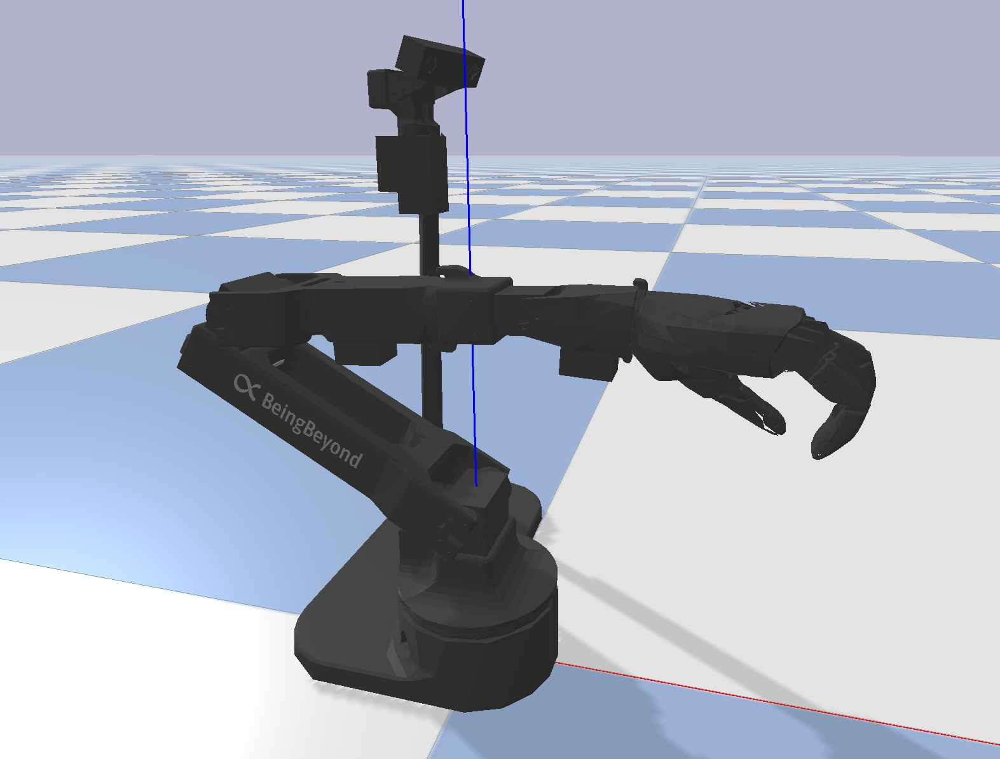

# BeingBeyond D1 EDU SDK — Jetson Orin NX

<p align="center"></p>

用于 Jetson Orin NX 的 ARM64 二进制 SDK、示例和安装说明。
SDK 版本 **0.2.0**，提供 CPython **3.8 / 3.9 / 3.10 / 3.11** wheel。
默认运行环境为 Ubuntu 22.04、Python 3.10。

已验证设备：Jetson Orin NX 8GB、Ubuntu 22.04.5、L4T R36.4.3、内核 `5.15.148-tegra`。
CPython 3.8 / 3.9 / 3.10 / 3.11 均已通过软件验证。
Python 3.10 的示例 **1（灵巧手及触觉窗口）、2（头臂舵机）、3（双目相机窗口）**
已通过真机/GUI 验证；3.8 / 3.9 / 3.11 的真机/GUI 尚未实测。
以上真机记录针对原固定端口版本。本次自动识别与预检查改动仅完成无硬件回归，尚需在 NX 真机复验。
跨 Python 版本的真机/GUI 验证结果不能由 3.10 的结果直接推定。
示例 0、4～10 和其他选配功能尚未测试，不属于本次已验收范围。

运动示例会使能并控制真实机器人。运行前清空运动空间，保持实体急停可触及。

- [Python 版本选择与安装](docs/PYTHON_VERSIONS.md)
- [设备与端口核对](#4-设备权限与-can)
- [报错与对应设备排查](#6-报错与对应设备排查)
- [PCAN-USB 驱动与重启恢复](lib/pcan/README.md)
- [发布说明及已知限制](docs/RELEASE_NOTES.md)
- [第三方组件与许可证](THIRD_PARTY_NOTICES.md)

## 1. 文件内容

```text
Beingbeyond_D1_edu_nx/
  README.md
  LICENSE
  THIRD_PARTY_NOTICES.md
  .gitignore / .gitattributes
  SHA256SUMS
  requirements-jetson-py{38,39,310,311}.lock.txt
  lib/
    beingbeyond_d1_edu_sdk-0.2.0-cp*-cp*-linux_aarch64.whl
    dependencies/py38/     ECOS wheel、对应源码和许可证
    pcan/                  内核模块、对应源码和许可证
    dex-retargeting/        可选库、模型和许可证，未在 NX 验收
  examples/                D1 示例及辅助模块
    device_detection.py    自动识别、通信预检查及错误定位
  tools/                   不访问硬件的安装与 IK 验证
  docs/                    版本选择、发布说明
  avp_teleop/               未验收的仿真遥操作参考
  utils/                   工具脚本，部分会操作真实硬件
```

SDK 四个核心编译为 AArch64 `.so`，wheel 不含核心 `.pyx` 或生成的 C/C++。
Python 封装和示例仍为明文。这是二进制形式的源码保护，不是密码学加密或不可逆向保证。
SDK 私有构建源码和本地开发环境不属于本发行内容。
PCAN/ECOS 的公开源码归档属于其各自的配套发布材料。

## 2. 新 NX 安装（默认 Python 3.10）

以下假定用户名为 `nvidia`，仓库目录为 `/home/nvidia/Beingbeyond_D1_edu_nx`。
如果仓库名称、用户名或路径不同，请相应替换；可在克隆时显式指定目录名。
本包需要联网安装其余依赖，不是完整离线安装包。

先确认目标架构、解释器和文件完整性：

```bash
uname -m
/usr/bin/python3.10 --version
cd /home/nvidia/Beingbeyond_D1_edu_nx
sha256sum -c SHA256SUMS
```

预期架构为 `aarch64`。不能在 x86 安装这些 ARM64 wheel，也不能更改文件名来改变 ABI。
确认系统包安装方案后，补齐依赖并创建**新的**运行环境：

```bash
sudo apt-get update
sudo apt-get install python3.10-venv libgl1 libglib2.0-0 v4l-utils usbutils
mkdir -p /home/nvidia/d1_edu_deploy
/usr/bin/python3.10 -m venv /home/nvidia/d1_edu_deploy/venv-py310
/home/nvidia/d1_edu_deploy/venv-py310/bin/python -m pip install \
  -r /home/nvidia/Beingbeyond_D1_edu_nx/requirements-jetson-py310.lock.txt
/home/nvidia/d1_edu_deploy/venv-py310/bin/python -m pip install --no-deps \
  /home/nvidia/Beingbeyond_D1_edu_nx/lib/beingbeyond_d1_edu_sdk-0.2.0-cp310-cp310-linux_aarch64.whl
/home/nvidia/d1_edu_deploy/venv-py310/bin/python -m pip check
```

如果该 venv 已存在，先核对并复用，不要盲目重建。
不要使用 sudo pip、替换系统 Python 或改动 ROS/CUDA 环境。
示例 1～3 不需要 Isaac Gym、PyTorch、MediaPipe、PyBullet 或 dex-retargeting。
Python 3.8/3.9/3.11 应使用各自的 wheel 和锁定文件，详见版本选择说明；
不要执行 `pip install lib/*.whl`。Python 3.8 安装时还需指定随附 ECOS 的 find-links 目录。

## 3. 无硬件验证

以下命令只验证安装和数值计算，不打开串口、CAN 或相机，不发送运动命令：

```bash
cd /home/nvidia/Beingbeyond_D1_edu_nx
/home/nvidia/d1_edu_deploy/venv-py310/bin/python tools/check_sdk_binary.py \
  --wheel lib/beingbeyond_d1_edu_sdk-0.2.0-cp310-cp310-linux_aarch64.whl \
  --runtime --expected-prefix /home/nvidia/d1_edu_deploy/venv-py310
/home/nvidia/d1_edu_deploy/venv-py310/bin/python tools/check_sdk_ik.py
/home/nvidia/d1_edu_deploy/venv-py310/bin/python examples/4_control_d1.py --help
```

检查覆盖 ELF/ABI、核心打包、安装来源、URDF/网格、FK、QP 和 SDK 单步 IK。
`--help` 或软件验证成功不等于示例 4 的实际运动已通过。
Python 运行后出现的 `__pycache__` 是本地缓存，不应提交；重新校验不会要求它们存在。

## 4. 设备、权限与 CAN

### 4.1 当前端口选择方式

**示例 1～10 的硬件配置默认使用 `auto`，与普通版共用相同的识别逻辑。**
启动时根据 USB 身份筛选候选设备，再按角色验证串口协议；不依赖串口编号、插入顺序或特定设备的 USB 序列号。
识别成功会输出实际映射，例如 `[auto] head_arm -> /dev/ttyACM2`。

| 设备角色 | 自动识别依据 |
| --- | --- |
| 头臂 | USB `1a86:55d3`；1 Mbps 下验证 8 个舵机 ID 的回复及校验和 |
| 手套 | USB `1a86:55d3`；115200 baud 下连续收到 3 帧有效六通道 `ANGLES:` 数据 |
| 外骨骼 | USB `1a86:7523`；115200 baud 下验证配置的舵机 ID 和位置应答范围 |
| 手部 CAN | USB `0c72:000c` 对应的 SocketCAN 接口，排除原生 NVIDIA CAN |
| 双目相机 | USB `15aa:1955`、video index 0；优先返回对应的 by-id 路径 |

头臂和手套使用相同 USB 型号，检测时先监听手套协议，确认是手套后不会发送头臂查询。
候选端口被占用、无有效回复或存在多个可用设备时会报错，不按编号选择第一个设备。
其他 USB 型号、多台同型号设备或需要固定绑定时，可显式指定路径或接口。
运动示例仍会对显式指定的串口执行协议验证；显式配置只绕过 USB 身份筛选，不绕过通信预检查。

使用 CAN 的运动示例会先验证接口状态、波特率和所选左/右手的实际应答；
使用 `D1Robot` 的示例及示例 8/10 还会在控制器初始化前检查相机取帧。
预检查只监听、读取串口寄存器/位置、请求 CAN 状态或采集图像，不使能舵机、不移动关节，也不配置 CAN。
打开串口仍可能使部分控制板复位。

机器人正常供电后，分别连接 USB 串口、PCAN-USB 和 USB 相机。
三条链路互相独立，连接控制器不代表已连接相机。

| 项目 | 验证设备的设置 |
| --- | --- |
| 手部 CAN | PCAN 提供的 `can1`，1 Mbps |
| 头臂串口 | `/dev/ttyACM0`，1 Mbps |
| 相机 | `/dev/v4l/by-id/usb-SunplusIT_Inc_SPCA2100_PC_Camera-video-index0` |
| 相机采集请求 | MJPG，1280×480，30 FPS；每眼 640×480 |

上表是已验证设备的设置，不保证在其他机器或重新插拔后保持相同编号。
设备节点存在仅说明系统已枚举设备，不代表串口属于头臂控制器、CAN 上有手部应答或相机可以正常取帧。

### 4.2 核对实际设备

先查看 USB、串口、相机和网络接口；以下命令不发送机器人运动命令：

```bash
lsusb
ls -l /dev/ttyACM* /dev/ttyUSB*
ls -l /dev/serial/by-id/ /dev/v4l/by-id/
v4l2-ctl --list-devices
id -nG
ip -details link show
```

某类设备未连接时，对应的 `ls` 可能提示不存在，继续检查所需设备即可。
核对具体节点时，将下列设备名替换为本机实际值：

```bash
udevadm info --query=property --name=/dev/ttyACM0
readlink -f /dev/v4l/by-id/usb-SunplusIT_Inc_SPCA2100_PC_Camera-video-index0
readlink -f /sys/class/net/can1/device
ip -details -statistics link show can1
```

USB 型号或 VID/PID 只能帮助确认候选设备；同型号适配器可能连接不同控制器，不能仅凭它判定设备角色。
有多个同型号串口设备时，可在停止控制程序后逐个拔插，对照节点变化确认接线。
若存在能唯一对应控制器的 `/dev/serial/by-id/...` 链接，可将其用作显式串口路径。

### 4.3 配置示例使用的端口

| 示例 | 当前配置 | 实际设备不同时的修改位置 |
| --- | --- | --- |
| [1：灵巧手](examples/1_control_hand.py) | `resolve_devices(can_iface="auto", check_ready=True)` | `main()` 中传入 `resolve_devices` 的 `can_iface` |
| [2：头臂](examples/2_control_head_arm.py) | `resolve_head_arm("auto")` | `main()` 中传入 `resolve_head_arm` 的串口路径 |
| [3：相机](examples/3_show_vision.py) | `device = "auto"` | `main()` 中的 `device` |
| [4：整机联动，未验收](examples/4_control_d1.py) | 头臂、手部 CAN、相机均为 `auto` | 命令行参数 `--arm-dev`、`--hand-can`、`--camera` |
| [7](examples/7_exo_teleop_sim.py) / [8](examples/8_exo_teleop_real.py)：外骨骼与手套遥操作，未验收 | 配置类中的端口均为 `auto` | `TeleopSimCfg` / `TeleopRealCfg`；示例 8 的 `enable_camera=False` 会跳过相机识别和取帧 |

示例 1～3 没有上述端口命令行参数，需要修改各自脚本中的配置。
修改发行文件后，对应的 `SHA256SUMS` 校验会与原始发行包不同；保留原始发行包用于比对。

### 4.4 CAN 驱动与权限

验证设备的原生 `can0` 属于 NVIDIA `mttcan`，不是 USB PCAN。
驱动加载、接口确认和 1 Mbps 配置见 [PCAN 说明](lib/pcan/README.md)。
**附带驱动没有自动加载/开机拉起配置，重启或拔插后需要检查并手动恢复。**
`.ko` 必须与目标内核 ABI 匹配，不能仅凭 ARM64 架构相同就加载。
运行运动示例或下文 `--check` 前，须按 PCAN 说明将确认的接口配置为 UP、1 Mbps。
自动识别只选择接口，不自动加载驱动或拉起总线；总线未就绪时会在控制器初始化前报错。

缺少串口/视频权限时，确认后将运行用户加入对应组：

```bash
sudo usermod -aG dialout,video nvidia
```

注销桌面并重新登录使组权限生效。旧终端不一定获得新组权限；
只需临时处理串口权限时，可在该终端运行 `newgrp dialout`。
无需将设备改成 chmod 777，也不建议用 sudo 启动 GUI 示例。

### 4.5 不初始化控制器的设备诊断

以下工具独立于 SDK 控制器。`--list` 仅列出串口身份，不打开端口；
`--check` 会执行上述通信预检查，不发送运动命令。默认检查全部角色，可用 `--roles` 限定范围：

```bash
cd /home/nvidia/Beingbeyond_D1_edu_nx
/home/nvidia/d1_edu_deploy/venv-py310/bin/python examples/device_detection.py --list
/home/nvidia/d1_edu_deploy/venv-py310/bin/python examples/device_detection.py --roles head_arm can camera --check
/home/nvidia/d1_edu_deploy/venv-py310/bin/python examples/device_detection.py --roles exo glove --check
```

CAN 默认检查右手；检查左手时加 `--hand-type left`。
不加 `--check` 时，串口仍执行协议读取，CAN 和相机仅按硬件信息识别。
开发用模拟回归测试由维护环境执行，不包含在本发行目录中。
客户可使用第 3 节工具验证安装，使用本节工具验证已连接的设备。

## 5. 依次运行示例 1～3

示例 1～3 有原版本真机验收记录；当前自动识别版本的真机/GUI 仍需复验。

在 NX 本地桌面终端执行，每项退出后再运行下一项，不要同时启动多份控制程序：

```bash
cd /home/nvidia/Beingbeyond_D1_edu_nx/examples
/home/nvidia/d1_edu_deploy/venv-py310/bin/python 1_control_hand.py
/home/nvidia/d1_edu_deploy/venv-py310/bin/python 2_control_head_arm.py
/home/nvidia/d1_edu_deploy/venv-py310/bin/python 3_show_vision.py
```

- 示例 1 自动识别 PCAN 并验证手部应答，然后执行手部动作并显示触觉窗口。
- 示例 2 自动识别并验证头臂串口，然后使能头臂舵机并执行预设运动。
- 示例 3 通过 USB/V4L2 显示双目相机；不是 CSI/Argus 管线。

窗口中的 `q` 用于退出，不代替实体急停。普通 SSH 不自动拥有桌面 GUI 显示能力。

## 6. 报错与对应设备排查

排查时同时记录：运行的示例、配置的设备路径或接口名、完整异常信息。
预检查报错会携带角色、候选端口及失败原因；运行包装层会补充所选端口与阶段，例如
`[device] hand CAN port=can1 stage=status check: ...`。
CAN 与相机的识别/通信错误会一起汇总；若其中任一失败，串口探测会跳过并明确列出未检查的角色。
底层 SDK 个别直接调用仍可能只提供原始异常，应保留完整异常链；启动检查通过也不能保证运行期间设备不会断开。

| 报错或现象（文字可能因底层库而异） | 对应设备 | 优先检查 |
| --- | --- | --- |
| `[auto] ... no verified device`、`ambiguous devices` | 消息中列出的角色及候选端口 | 检查候选被排除的原因；多个匹配设备时显式配置目标，未枚举设备时检查 USB 与驱动 |
| `identified as glove`、`error status 0x...` | 消息中的串口及舵机 ID | 前者表示头臂候选实际为手套；后者表示舵机已回复故障状态，不应当作舵机缺失 |
| `Failed to open port ...`、串口 `Permission denied` 或 `No such file or directory` | 示例配置的头臂串口；示例 7/8 也可能是外骨骼或手套串口 | 路径是否存在、实际连接对象、当前会话 `dialout` 权限、端口占用 |
| 串口能打开，但舵机读取超时、ID 无应答或通信异常 | 头臂串口及下游舵机链路 | 控制器是否选对、机器人供电、1 Mbps 波特率、接线和舵机 ID；超时不能直接证明舵机缺失 |
| `CAN config failed`、`CAN up failed` 或 CAN 接口不存在 | 示例配置的 CAN 接口 | 是否误用了原生 `can0`、PCAN 是否枚举并加载驱动、配置命令的权限；按 PCAN 说明恢复 |
| CAN 接口存在，但手部无数据或状态读取异常 | CAN 总线及手部设备 | 接口是否正确、是否 UP、波特率是否为 1 Mbps、是否 BUS-OFF、供电和接线；接口 UP 不等于手部有应答 |
| `Could not open camera: ...` | 消息中的相机路径 | USB 枚举、by-id 链接目标、`video` 权限、设备占用；不要在尚未枚举时直接改成 `/dev/video0` |
| `Failed to read frame`、`Frame size is too small`、`D1 camera capture failed` | 当前配置的相机 | 查看完整异常链确认设备与原因，核对采集格式、分辨率、USB 连接和带宽 |
| Qt、显示服务器或 GUI 窗口初始化错误 | 本地图形会话 | 是否在 NX 桌面终端运行、`DISPLAY`/`WAYLAND_DISPLAY` 是否有效；GUI 错误不能直接归因于相机端口 |

可用下面的命令查看节点权限和占用。`fuser` 由系统包 `psmisc` 提供，仅在已安装时使用：

```bash
ls -l /dev/ttyACM0 /dev/v4l/by-id/usb-SunplusIT_Inc_SPCA2100_PC_Camera-video-index0
id -nG
fuser -v /dev/ttyACM0
fuser -v /dev/v4l/by-id/usb-SunplusIT_Inc_SPCA2100_PC_Camera-video-index0
```

将路径替换为实际设备。`fuser` 的可见范围受进程权限限制，没有输出也不能完全排除占用。
若显示占用 PID，先确认对应程序，再正常退出该程序；这些命令不会结束进程。
设备已经断开、节点不存在时，报错中的路径只是本次尝试打开的配置值，不能据此判断实际设备现在位于哪个端口。

## 7. 已知边界与选配功能

- 示例 4 默认自动识别，仍可用 `--arm-dev`、`--hand-can`、`--camera` 显式选设备。
  `--no-vision` 跳过相机识别和取帧；`--headless` 保留相机采集但不显示窗口。
  设备预检查通过不等于整机联动已验收，运行前仍需核对设备和运动范围。
- 示例 0、4～10、`avp_teleop/`、`utils/` 为额外参考，不保证其全部设备、仿真与依赖可在 NX 使用。
- 附带 dex-retargeting 的安装描述为 Python `>=3.7,<3.11`，且未在 NX 验收；
  SDK 的四版本支持矩阵不自动涵盖该可选库。不要在已验收 venv 中直接安装全部选配依赖。
- 采集参数为请求值，不是相机持续帧率、延迟或丢帧性能承诺。
- 更换 Python 小版本、JetPack、发行版/glibc 或内核时需重新验证。

依赖锁定文件不含下载哈希、系统包或全部第三方 wheel。各 SDK 校验值见
[版本说明](docs/PYTHON_VERSIONS.md)，全部发布文件的相对路径校验见 `SHA256SUMS`。
